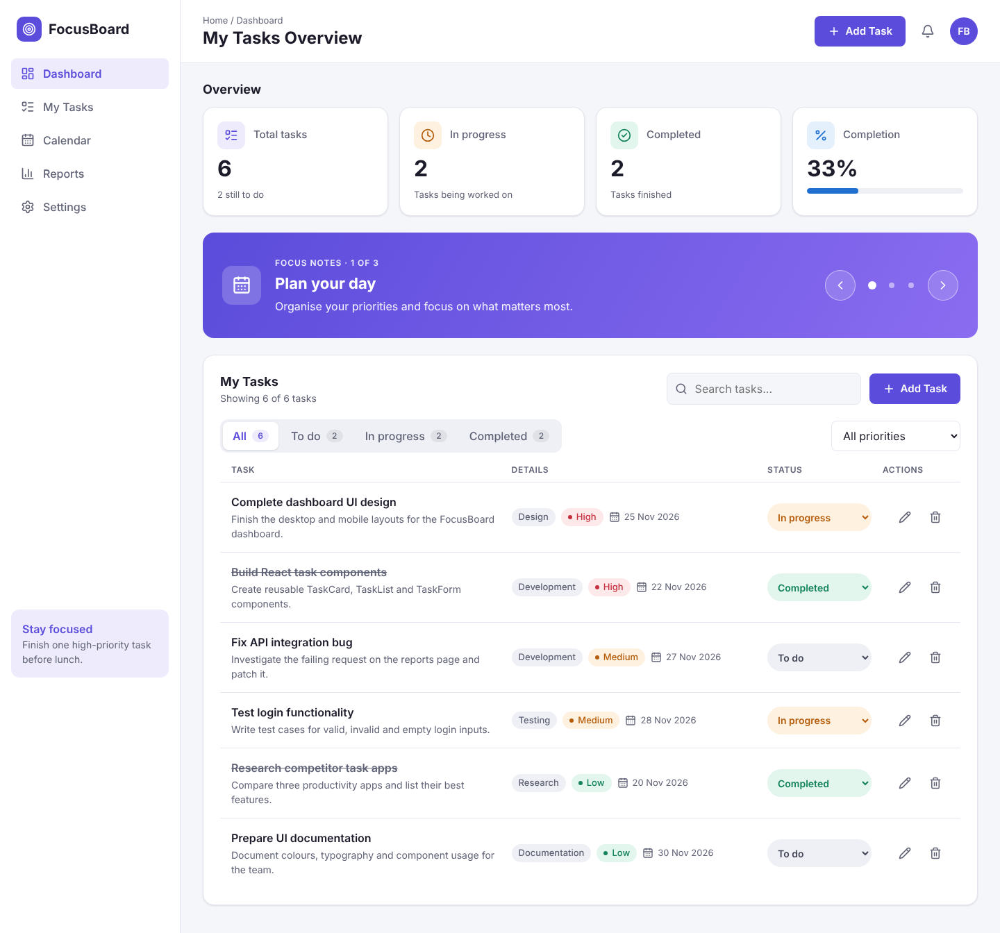
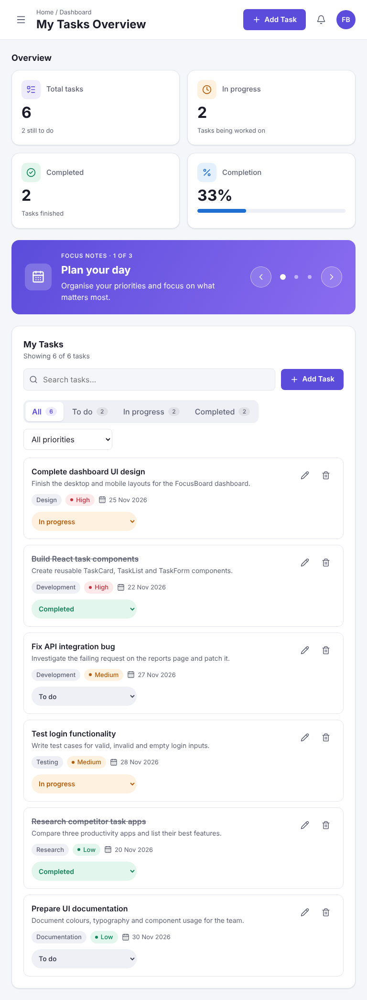
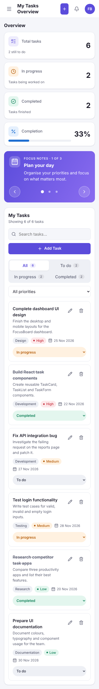

# FocusBoard

A responsive, single-user task management dashboard built with **React + Vite**. Users can create, edit, delete and update tasks, search and filter them, see live statistics, browse a three-slide Focus Notes carousel, and keep their data across browser refreshes with `localStorage`.

- **Live URL:** _add your Vercel/Netlify URL here_
- **GitHub repository:** _add your repository URL here_

## Screenshots

| Desktop (1440px) | Tablet (768px) | Mobile (390px) |
| --- | --- | --- |
|  |  |  |

Create-task form: [screenshots/create-task-form.png](screenshots/create-task-form.png) · Mobile navigation: [screenshots/mobile-menu.png](screenshots/mobile-menu.png)

## Tech stack

| Technology | Purpose |
| --- | --- |
| React 19 + Vite | Component-based UI and dev server/build |
| React Hooks (`useState`, `useMemo`, `useEffect`) | State management |
| Plain CSS (`src/index.css`) | Styling, layout and responsive breakpoints |
| Lucide React | Icons |
| localStorage | Browser persistence |

## Features

- **6 sample tasks** on first visit (unique id, title, description, category, status, priority, due date)
- **Create task** in a modal form with validation (empty or spaces-only title rejected, required due date, status and priority)
- **Edit task** using the same form, pre-filled with the task's values; the original id is kept, so no duplicates are created
- **Delete task** with an accessible confirmation dialog (Cancel / Delete)
- **Status updates** (To do, In progress, Completed) directly from each task row
- **Search** by title: case-insensitive, partial matches, updates while typing, with an empty state
- **Status tabs + priority filter** that work together with search, plus a Reset button
- **Statistics** (total, in progress, completed, completion %) calculated from task data, never hardcoded; zero tasks shows 0%
- **Focus Notes carousel** with 3 slides, Previous/Next buttons (circular), and clickable indicator dots
- **localStorage persistence** under the key `focusboard_tasks`
- **Responsive** layouts for 1440px, 768px and 390px
- **Accessibility**: semantic landmarks, labelled form fields, skip link, visible focus styles, keyboard-operable dialogs (Escape to close, focus trap, focus returns to the trigger), descriptive labels on icon buttons and carousel controls, and status/priority shown as text (not colour alone)

## Folder structure

```
src/
├── App.jsx                  # Holds task state, derived values and CRUD handlers
├── main.jsx                 # Entry point
├── index.css                # Global styles + responsive breakpoints
├── components/
│   ├── Sidebar.jsx          # Brand + navigation (drawer on tablet/mobile)
│   ├── Header.jsx           # Page title, Add Task, notifications, profile
│   ├── Statcard.jsx         # Reusable statistic card
│   ├── FocusNotes.jsx       # Three-slide carousel
│   ├── SearchBar.jsx        # Title search input
│   ├── FilterTabs.jsx       # Status tabs + priority filter + reset
│   ├── TaskList.jsx         # List + empty state
│   ├── TaskCard.jsx         # One task row/card
│   ├── TaskForm.jsx         # Create/Edit form
│   ├── ConfirmDialog.jsx    # Delete confirmation
│   └── Modal.jsx            # Accessible dialog wrapper
├── data/
│   ├── sampleTasks.js       # Initial six tasks
│   └── constants.js         # Statuses, priorities, categories, storage key
└── hooks/
    └── useLocalStorage.js   # useState that syncs with localStorage
```

## Run locally

```bash
npm install
npm run dev      # http://localhost:5173
npm run build    # production build in dist/
```

## State management

I used **React's built-in hooks** with no external library. The app is small and has one main piece of data (the task list), so Redux, Zustand or Context would add complexity without adding value.

- **Single source of truth:** `App.jsx` owns the full `tasks` array through the custom `useLocalStorage` hook. Every component receives the data and callbacks it needs as props.
- **Immutable updates:** create uses `[newTask, ...previous]`, edit and status changes use `map()` returning a new object only for the matching id, and delete uses `filter()`. Existing state is never mutated.
- **Derived values:** statistics, search results, tab counts and the visible list are calculated with `useMemo` from `tasks` + the filter state. They are never stored separately, so they can't get out of sync.
- **Filters:** `searchText`, `statusFilter` and `priorityFilter` are separate pieces of state that are applied together to the full list.
- **Form/dialog state:** `form = { isOpen, task }`. If `task` is `null` the form creates a task, otherwise it edits that task. `taskToDelete` controls the confirmation dialog.
- **Carousel state:** `FocusNotes` keeps its own `activeIndex`. The visible slide, the "1 of 3" label and the active dot are all read from that one value. Navigation is circular using modulo arithmetic.

## localStorage

`useLocalStorage(key, initialValue, isValid)`:

1. On first render it reads `focusboard_tasks`. If nothing is saved, the six sample tasks are used. If something is saved, it is used instead, so sample data never overwrites the user's work.
2. Saved data is parsed with `JSON.parse` inside `try/catch` and checked by `isValidTaskList`. Corrupted or invalid data falls back to the sample tasks instead of crashing the app.
3. A `useEffect` writes the full task list (not the filtered view) back as JSON whenever it changes.

To start over, run `localStorage.removeItem("focusboard_tasks")` in the browser console and refresh.

## Known limitations

- Sidebar items other than **Dashboard** (My Tasks, Calendar, Reports, Settings), the notification bell and the profile avatar are visual placeholders.
- I did not have access to the Figma frames, so the layout, colours and Focus Notes slide text follow the written assignment brief and reference material rather than the exact Figma values.
- Data is stored per browser. There is no backend or sync between devices, as specified.
